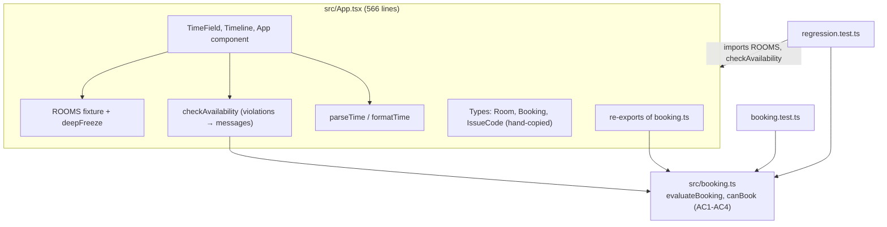
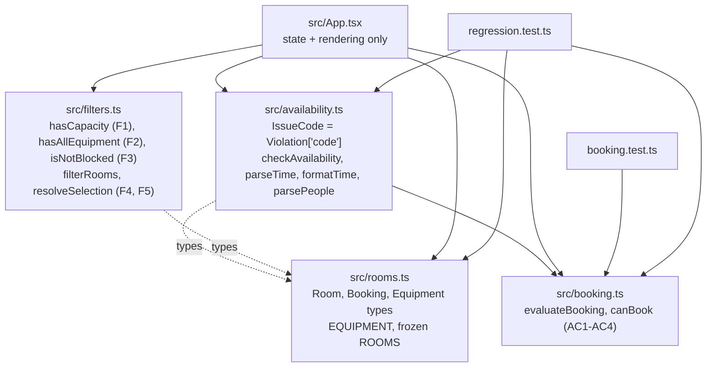

# Architecture – Assignment #04

## Before (Practice Work #09)

Room data, message mapping, parsing and React components all lived in `App.tsx`. Tests imported
data and logic from the UI module, and `App.tsx` re-exported rule functions from `booking.ts`.

## After (Assignment #04, Approach A: functional core with separate modules)

Each module has one job, and every module except `App.tsx` is pure TypeScript that can be tested without React.

Data flow for one render: raw inputs → `parsePeople` / `parseTime` → `filterRooms(ROOMS, criteria)` →
`resolveSelection(results, roomId)` → `checkAvailability(room, start, end, now)` → render. All state
other than the raw inputs is derived on each render, and `ROOMS` stays deeply frozen.

**Pattern used (1 of the 2 allowed):** a Specification-style predicate list in `filters.ts`. F1-F3 are each
a `(room, criteria) => boolean` predicate, and `filterRooms` keeps a room only if every predicate in
`ROOM_FILTERS` holds.

## Approaches considered

**Approach A: functional core with separate modules (chosen).**
- Files: `rooms.ts` (frozen data) → `booking.ts` (rules, unchanged) → `filters.ts` (pure predicates) →
  `availability.ts` (rules turned into messages) → `App.tsx` (state and rendering only).
- Each filter rule is a small predicate `(room, criteria) => boolean`, and `filterRooms` requires all of them to pass.
- The only pattern is a Specification-style predicate list, so F1-F3 can be tested one by one and extended later.
- Everything stays a pure function and can be tested without React.

**Approach B: layered services with classes (rejected).**
- A `RoomRepository` interface with an `InMemoryRoomRepository`.
- One `FilterStrategy` class per rule (`CapacityStrategy`, `EquipmentStrategy`, `BlockedStrategy`).
- An `AvailabilityService` facade that combines the repository, the strategies and `evaluateBooking`.
- A `useRoomSearch()` hook that the UI uses.

### Why Approach B was rejected (an AI suggestion that was rejected)

The AI assistant proposed Approach B itself and then rejected it:

- **It breaks the 2-pattern limit in `AGENTS.md`.** Repository, Strategy and Facade are three patterns,
  plus a custom-hook layer.
- **The Repository doesn't solve a real problem.** "No backend" is a fixed constraint, so there is no second
  data source to swap in. It would also hide the frozen fixtures behind an interface, which makes the AC5
  "not mutated" check harder to see.
- **Strategy classes go against "prefer pure functions".** Each class has state and has to be created before
  tests can run, while a predicate is one line and is tested directly.
- **It's not a minimal change.** About 6 new files and a rewrite of how the UI gets its data, compared with
  moving existing code and adding one module in Approach A.

## Design decisions

- **F3:** blocked rooms are **excluded** from filter results. AC3 is still enforced by `evaluateBooking`
  (`ROOM_BLOCKED`), so the rule module stays correct for any room passed to it directly.
- **F5:** the selection is derived, not stored. `resolveSelection` keeps the user's chosen room while it matches
  and otherwise falls back to the first match, so no effect or extra state sync is needed.
- **Invalid "People" input** shows a field error, and capacity is not filtered until it is fixed.
